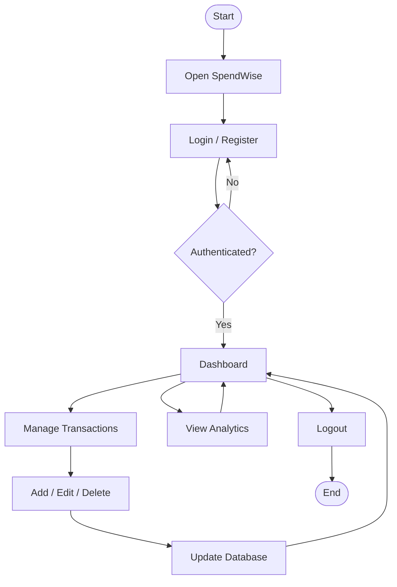
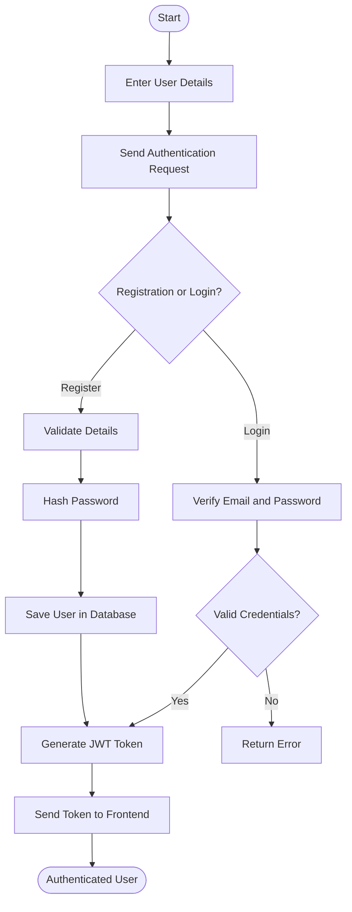
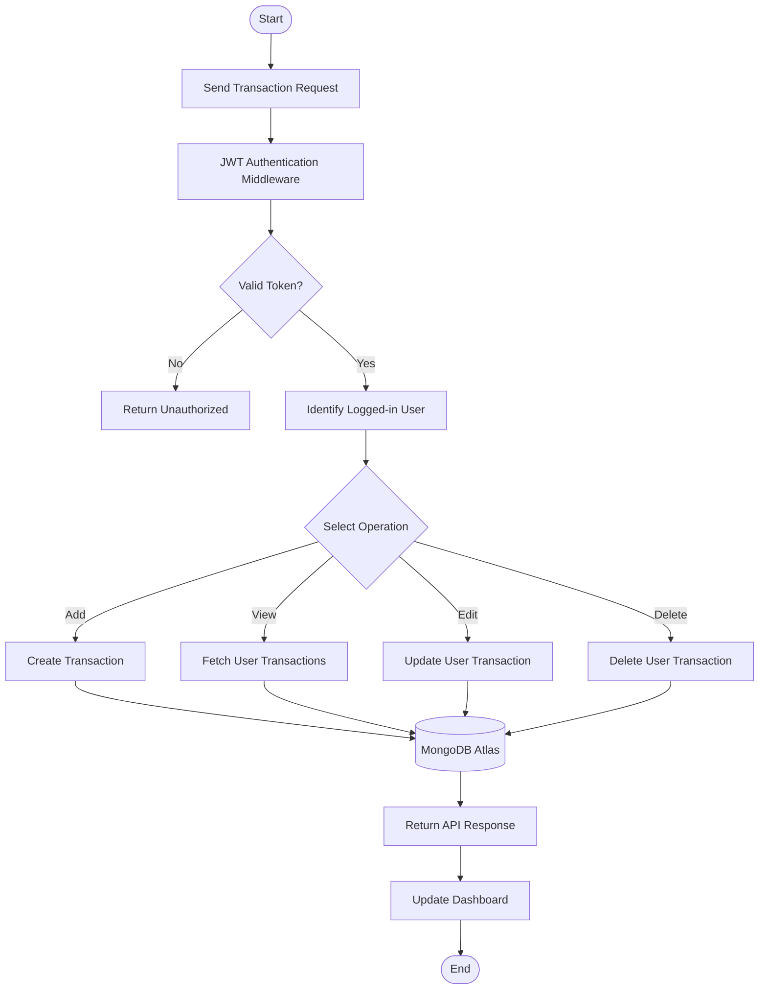
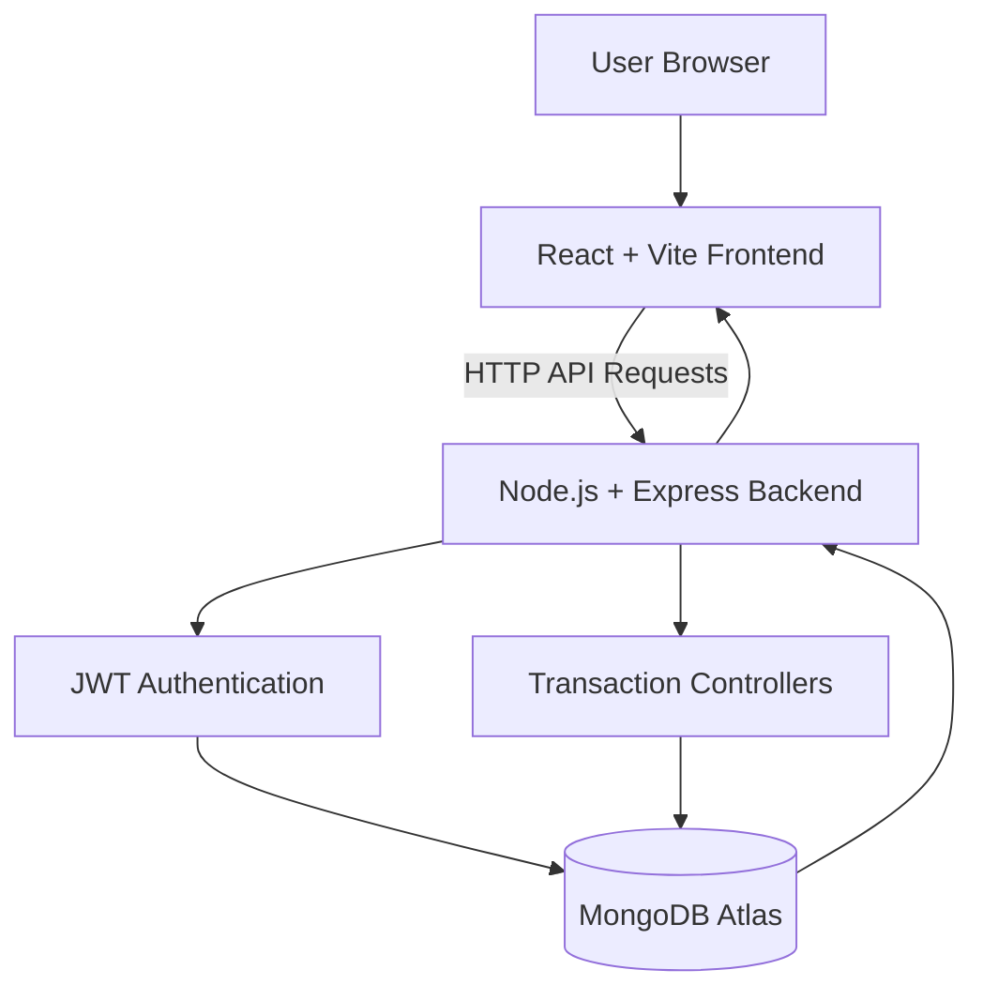

# SpendWise – Personal Finance Tracker

**Track your money. Understand your spending. Manage your finances smarter.**

SpendWise is a full-stack personal finance management application that allows users to record income, track expenses, manage transactions, and analyze their financial activity through an interactive dashboard.

The application supports multiple users, with each user having a separate account and private financial records.

## Live Application

- **Frontend:** https://spend-wise-beta-two.vercel.app/
- **Backend API:** https://spendwise-api-qu31.onrender.com

## Features

- User registration and login
- JWT-based authentication
- Secure password hashing using bcryptjs
- Personal financial dashboard
- Add, edit, and delete transactions
- Income and expense tracking
- Search and filter transactions
- Sort transactions by date and amount
- Monthly income and expense comparison
- Category-wise expense analysis
- Multi-user support with separate financial records
- Responsive user interface

## Technology Stack

| Component | Technology |
|---|---|
| Frontend | React.js, Vite |
| Styling | CSS3 |
| Icons | Lucide React |
| Charts | Recharts |
| Backend | Node.js, Express.js |
| Database | MongoDB Atlas |
| ODM | Mongoose |
| Authentication | JWT, bcryptjs |
| Deployment | Vercel, Render |

## Project Structure

```text
SpendWise/
│
├── frontend/
│   ├── public/
│   └── src/
│       ├── components/
│       ├── pages/
│       ├── services/
│       ├── App.jsx
│       ├── App.css
│       └── main.jsx
│
├── backend/
│   ├── config/
│   │   └── db.js
│   ├── controllers/
│   │   ├── authController.js
│   │   └── transactionController.js
│   ├── middleware/
│   │   ├── authMiddleware.js
│   │   └── errorMiddleware.js
│   ├── models/
│   │   ├── User.js
│   │   └── Transaction.js
│   ├── routes/
│   │   ├── authRoutes.js
│   │   └── transactionRoutes.js
│   ├── server.js
│   └── package.json
│
├── .gitignore
└── README.md
```

## Application Workflow

SpendWise follows a simple client-server architecture. Users authenticate themselves before accessing their financial information.

### 1. Overall Application Flow



### 2. User Authentication Flow



### 3. Transaction Management Flow



### 4. System Architecture



## Getting Started

Follow these steps to run the project locally.

### Prerequisites

- Node.js and npm
- MongoDB Atlas account or a local MongoDB instance
- Git

### 1. Clone the Repository

```bash
git clone YOUR_GITHUB_REPOSITORY_URL
cd SpendWise
```

### 2. Backend Setup

```bash
cd backend
npm install
```

Create a `.env` file inside the backend folder:

```env
PORT=5000
MONGO_URI=your_mongodb_connection_string
JWT_SECRET=your_jwt_secret
CLIENT_URL=http://localhost:5173
```

Start the backend:

```bash
npm run dev
```

Backend URL:

```text
http://localhost:5000
```

### 3. Frontend Setup

Open another terminal:

```bash
cd frontend
npm install
```

Create a `.env` file inside the frontend folder:

```env
VITE_API_URL=http://localhost:5000/api
```

Start the frontend:

```bash
npm run dev
```

Frontend URL:

```text
http://localhost:5173
```

## API Overview

### Authentication Routes

| Method | Endpoint | Description |
|---|---|---|
| POST | `/api/auth/register` | Register a new user |
| POST | `/api/auth/login` | Login user |
| GET | `/api/auth/me` | Get authenticated user details |

### Transaction Routes

| Method | Endpoint | Description |
|---|---|---|
| GET | `/api/transactions` | Fetch user transactions |
| GET | `/api/transactions/:id` | Fetch a transaction |
| POST | `/api/transactions` | Add a transaction |
| PUT | `/api/transactions/:id` | Update a transaction |
| DELETE | `/api/transactions/:id` | Delete a transaction |

Protected transaction routes require a valid JWT token in the Authorization header.

## Security and Data Management

- Passwords are hashed before being stored in the database.
- JWT tokens are used to authenticate protected API requests.
- Each transaction is associated with its respective user.
- Transaction queries are restricted to the authenticated user's records.
- Environment variables are used to store database credentials and authentication secrets.

## Deployment Architecture

| Service | Platform |
|---|---|
| Frontend Hosting | Vercel |
| Backend Hosting | Render |
| Cloud Database | MongoDB Atlas |

## Future Improvements

- Monthly budget management
- Spending limit alerts
- Export transactions to CSV or PDF
- Recurring transactions
- Dark mode
- Financial reports and insights

## Developer

**Satyam Garg**

Computer Science Engineering Student

Full-stack development project built using React, Node.js, Express, and MongoDB.

---

**SpendWise – Make Every Transaction Count.**
